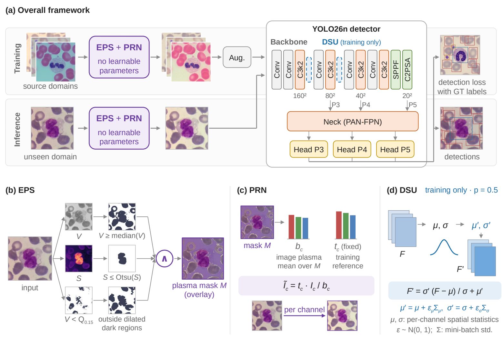

# PRDG

**Physics-Guided Domain Generalization for Blood Cell Detection via Plasma-Referenced Normalization**

PRDG combines envelope-based plasma selection (EPS), offline plasma-referenced normalization (PRN), and training-only domain shifts with uncertainty (DSU; [Li et al., ICLR 2022](https://arxiv.org/abs/2202.03958)) for leave-one-source-out blood-cell detection.



## Environment

Python 3.12.2; direct dependencies are pinned in `requirements.txt`. The OpenCV pin was deliberately changed to 4.10.0.84 to support NumPy 1.26.4. Historical and clean-environment versions are separately recorded in tests/environment.json and tests/clean_environment.json.

```bash
python -m venv .venv
# Activate the environment using your platform's activation command.
python -m pip install -r requirements.txt
python -m pip install -e . --no-deps
```

The pinned torch wheel is the CUDA 11.8 build. OpenCV is pinned to 4.10.0.84 with NumPy 1.26.4. No detector framework source is bundled. See VALIDATION.md for clean-environment checks and the historical environment record.

## Data

Download the official **1260-image TXL-PBC release** from [GitHub](https://github.com/lugan113/TXL-PBC_Dataset) or [Figshare v8](https://doi.org/10.6084/m9.figshare.27073186.v8).
Dataset reference: Gan, L., Li, X. & Wang, X. *A Curated and Re-annotated Peripheral Blood Cell Dataset Integrating Four Public Resources*. Scientific Data 12, 1694 (2025), [doi:10.1038/s41597-025-05980-z](https://doi.org/10.1038/s41597-025-05980-z).
Images, labels, weights and experiment caches are not included.

```bash
python scripts/prepare_txlpbc_lodo.py --root data/TXL-PBC --out data/folds
```

This copies the official data into isolated folds; it never hard-links or modifies input images/labels. Uses the original fixed per-source 15% validation split, split seed 42 plus a deterministic source-name hash. Each source partition is reused across folds. Source metadata and image order follow the original preparation script, not a new random split. Expected train/val/test counts: BCCD 935/165/160; PBC 646/114/500; Raabin-WBC 646/114/500; BCDD 986/174/100. Class order: 0 WBC, 1 RBC, 2 Platelets. Manifest counts do not prove all files are decodable; preserve corrupt-file reports and compare the dataset release, never silently replace labels or split membership.

## Reproduce the main experiment (4 folds × 3 seeds)

```bash
python scripts/train.py --folds data/folds --method PRN+DSU --protocol main --model yolo26n.pt --out outputs/prdg120
```

The command serially fits each target RGB reference using that fold's training images only, normalizes the copies, trains seeds 42/123/3407, selects best weights on source-internal validation, then performs a final held-out evaluation. `--method Baseline`, `PRN`, or `DSU` gives the other main-table arms. `--model yolov8n.pt` or `yolo11n.pt` uses the corresponding official COCO checkpoint; DSU wraps C2f/C3k2 outputs at indices 2/4 (strides 4/8). Checkpoints are downloaded by Ultralytics or supplied locally.

Main protocol: 640, batch4, maximum120 epochs, patience35, optimizer=auto, deterministic seed. The recorded auto choice is AdamW with initial base lr0.001429 for these three-class experiments. Keep auto rather than forcing a different optimizer schedule. Screening uses `--protocol screen` (40 epochs, patience40). Strong HSV changes only h/s/v to 0.03/0.9/0.6. Offline PRN precedes all training augmentation. DSU p0.5, factor1, eps1e-6; eval and singleton-batch identity. No learned parameters in EPS/PRN. `masked_mean` uses the whole-image mean when the mask contains fewer than 64 pixels. EPS guarantees at least 3% coverage (or its bright-pixel fallback); at the image sizes used in these experiments this prevents the <64-pixel case. This is not a guarantee for arbitrary tiny inputs.

```bash
python scripts/evaluate.py --weights outputs/prdg120/BCCD_seed42/fit/weights/best.pt --data outputs/prdg120/inputs/BCCD/data.yaml --out outputs/evaluation
python scripts/stats.py --csv outputs/baseline120/completed_evaluations.csv outputs/prdg120/completed_evaluations.csv --reference Baseline --out outputs/table2
python scripts/stats.py --csv outputs/baseline40/completed_evaluations.csv outputs/method40/completed_evaluations.csv --reference Baseline --out outputs/table3
```

AP evaluation: FP32 (`quantize=None`),640,batch2,conf0.001,iou0.7,max_det300. YOLO26's default end-to-end head is retained: passing iou does not imply IoU suppression executes. Do not force `end2end=False` when reproducing the recorded table. For non-end-to-end detectors the same validator uses their native NMS path.

Statistics pair by domain and seed, use sample SD,100000 bootstrap resamples with seed0 and percentile95%CI, two-sided Wilcoxon (zero_method=wilcox,method=auto). Missing pairs are not imputed; duplicates/mixed protocols are rejected. Twelve seed-domain pairs share four domains, so they are not twelve independent domains. Secondary tests are unadjusted.

## Recorded main results

mAP50-95 (%), mean ± sample SD across seeds. Direct export of `tables/main_120_mean_sd.csv`; per-run values and relative source evidence are in `tables/main_120_raw.csv`. Four-domain average SD is computed across seed-wise domain averages, not the mean of domain SDs.

| Method | BCCD | PBC | Raabin-WBC | BCDD | Four-domain mean |
|---|---:|---:|---:|---:|---:|
| Baseline | 66.40 ± 0.37 | 77.38 ± 1.08 | 56.79 ± 3.91 | 44.03 ± 3.66 | 61.15 ± 2.11 |
| DSU | 65.98 ± 1.93 | 77.18 ± 2.00 | 61.37 ± 3.48 | 44.18 ± 1.56 | 62.18 ± 2.16 |
| PRN | 69.50 ± 0.99 | 78.65 ± 0.31 | 58.04 ± 1.53 | 47.38 ± 0.35 | 63.39 ± 0.55 |
| PRN+DSU | 69.70 ± 0.23 | 78.59 ± 2.14 | 60.44 ± 1.84 | 48.60 ± 2.03 | 64.33 ± 0.71 |

Raabin-WBC and BCDD platelet APs have **very few annotated examples**. Per-class APs and the complete screening comparison are in `tables/`; do not compare 40- and 120-epoch rows as the same protocol.

## Comparisons and ablations

Supported CLI methods: Baseline, DSU, PRN, PRN+DSU, Strong HSV, MixStyle, Reinhard, Macenko, Vahadane, BeerLaNet+DSU, PRN+BeerLaNet+DSU, and B0--B6. B1=brightness-only Otsu, B5=whole-image gray-world reference, B6=per-channel99th-percentile white point. These reference ablations keep DSU and the original fixed PRN target; B5 is not neutral-gray correction. B2=Lab k-means, B3=channelwise morphological reference, B4=local reference. B3 kernel ratio is determined on source-training annotations only, as in the paper diagnostic; no target-label tuning. Stain templates use the first training image sorted by (source,new_name). The selected template and fitted target are recorded for every fold.

BeerLaNet dagger uses the unchanged official core with a self-implemented detection adapter; see `THIRD_PARTY_NOTICES.md` for the pinned commit, SHA and license. Download upstream separately; set `BEERLANET_SRC` before selecting this method. No unofficial replacement is silently substituted.

```bash
python scripts/eps_sensitivity.py --fold data/folds/BCCD --out outputs/eps_sensitivity
python scripts/reference_ablation.py --fold data/folds/BCCD --out outputs/references
python scripts/gain_robustness.py --weights-csv configs/gain_weights.example.csv --out outputs/gains
```

Gain manifest paths are relative to the manifest file; raw held-out images must be provided, even for normalized models. Gain multiplication, clipping and np.rint occur first, then EPS/reference estimation is repeated. Normalization uses the fixed training target. Invariance is conditional on stable masks and inactive clipping; measured perturbations include clipping.

## Verification

`tests/compare_original.py` checks20 real images against the original functions, plus exact seeded DSU/MixStyle outputs. `tests/check_splits.py` verifies all original fold memberships and order. `tests/test_modules.py` tests fallback/eval semantics. Full validation evidence and limitations: `VALIDATION.md`. A one-epoch `--smoke` run is not a scientific result and is rejected by the paper statistics command.

## Citation

Publication metadata is intentionally a placeholder in `CITATION.bib`; do not infer authors or a DOI.

## License

PRDG is released under **AGPL-3.0-only**, consistent with its use and extension of Ultralytics. See LICENSE for the full GNU Affero General Public License version 3. BeerLaNet and MixStyle retain their MIT notices in licenses/ and THIRD_PARTY_NOTICES.md. The DSU module is an independent implementation from the paper, with numerical compatibility checked against the original experiment implementation. Dataset and external dependencies retain their own terms.
